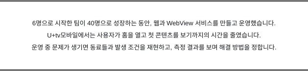
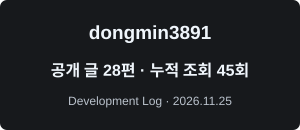
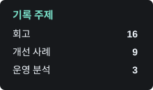
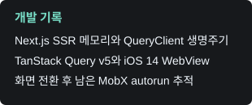
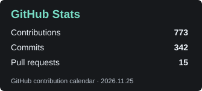
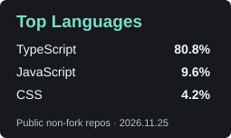

<h1 align="center">안녕하세요.  프론트엔드 개발자 김동민입니다</h1>

 

  <picture>
    <source media="(prefers-color-scheme: dark)" srcset="./assets/introduce-dark.svg">
    
  </picture>

 

  <a href="https://ddongmy.com/resume">
    <picture>
      <source media="(prefers-color-scheme: dark)" srcset="./assets/resume-dark.svg">
      
    </picture>
  </a>
     
  <a href="https://sudden-minute-b6b.notion.site/422151dc9c7281e1aaaffe65212c857c">
    <picture>
      <source media="(prefers-color-scheme: dark)" srcset="./assets/portfolio-dark.svg">
      
    </picture>
  </a>

 

<h2 align="center">Tech Stacks 🛠</h2>

  

 

<h2 align="center">
  Development Log ✍️
  
</h2>

  

  
  

📚 <b>GitHub Stats</b>

 

  
  

